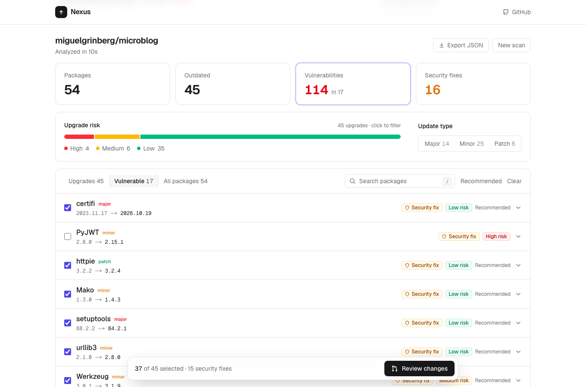
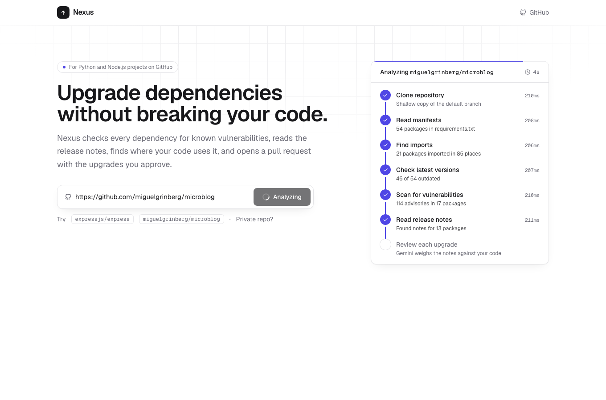
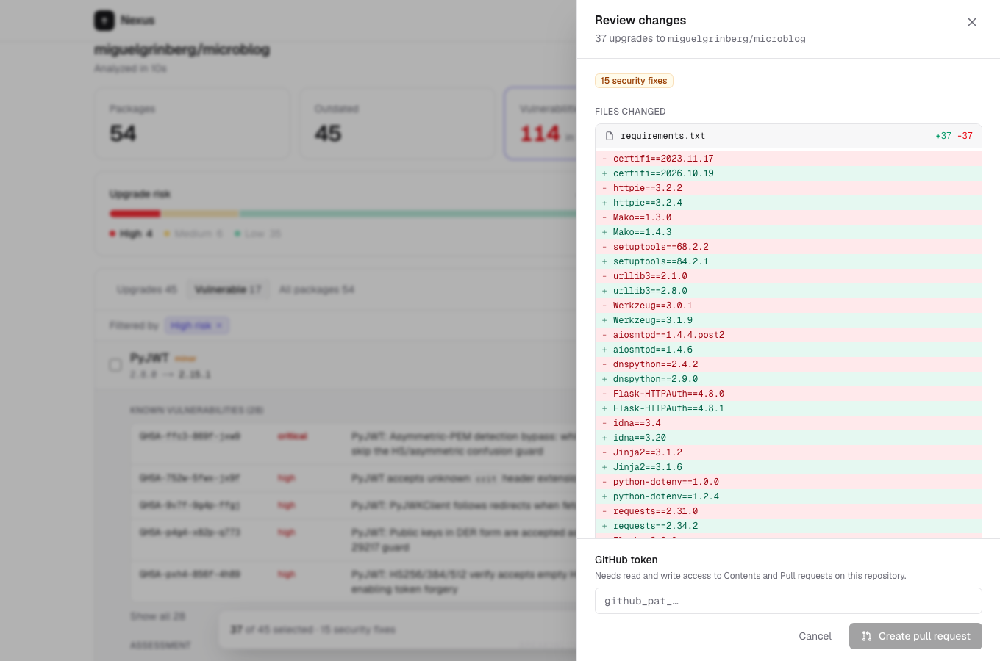
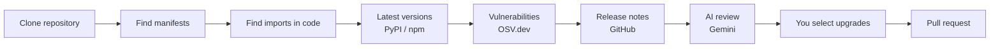

# Nexus

**Upgrade dependencies without breaking your code.**

Nexus scans a GitHub repository's Python and Node.js dependencies, checks each one for known vulnerabilities, reads the upstream release notes, finds where your code uses it, and opens a pull request with the upgrades you approve.

**[Live demo →](https://nexus-rosy-eight.vercel.app)**



## Why

Dependency bots can tell you a newer version exists. What they don't tell you is whether upgrading will break *your* code. Nexus answers that question with evidence:

- **Real vulnerability data.** Every package is checked against [OSV.dev](https://osv.dev). Upgrades that fix a known advisory are flagged and listed first.
- **Grounded in release notes.** The AI reads the actual changelogs between your version and the latest, not just the version numbers.
- **Specific to your code.** Nexus finds every place you import a package and points to the exact lines a breaking change could affect. Any location the model cites that doesn't match a real import is discarded.
- **You stay in control.** Review the exact file diff before anything is pushed. Nexus only opens a pull request; it never merges.

## Features

- **Live progress.** Each step of the analysis streams to the browser as it happens.

  

- **Interactive results.** Filter by risk level, update type (major / minor / patch) or vulnerability status, search with <kbd>/</kbd>, and expand any package for its advisories, assessment, breaking changes and affected code.
- **Review before you ship.** See the exact changes to each manifest and a preview of the pull request description.

  

- **Monorepo support.** Finds manifests in any folder (up to four levels deep), and matches each package only against code in its own project folder.
- **Format-preserving edits.** `pyproject.toml` files are edited in place, so comments, extras like `uvicorn[standard]` and conditions like `; python_version >= '3.8'` are kept.
- **Export** the full analysis as JSON.

### Supported files

| Ecosystem | Files |
|---|---|
| Python | `requirements*.txt`, `pyproject.toml` (PEP 621, dependency groups, Poetry) |
| Node.js | `package.json` (`dependencies` and `devDependencies`) |

## How it works



1. **Clone** the repository (a shallow copy of the default branch).
2. **Find manifests** anywhere in the repo, skipping `node_modules`, virtual environments and build output.
3. **Find imports** of each package in the project's source files, including packages whose import name differs (`pyyaml` → `yaml`, `beautifulsoup4` → `bs4`).
4. **Look up latest versions** on PyPI and npm, in parallel.
5. **Check vulnerabilities** on OSV.dev, including the lowest version that fixes each advisory.
6. **Fetch release notes** for every version in between, from GitHub Releases or the project's changelog.
7. **Review each upgrade** with Gemini 2.5 Flash, in parallel batches. Each assessment gives a risk level, the specific breaking changes, a recommendation and the affected lines of code.
8. **Open a pull request** with the upgrades you select. The description lists security fixes, breaking-change notes and the lines to review.

## Tech stack

| Layer | Technology |
|---|---|
| Frontend | Next.js 16, React 19, TypeScript, Tailwind CSS 4 |
| Backend | FastAPI, Python 3.11, Server-Sent Events |
| AI | Gemini 2.5 Flash via LangChain |
| Data sources | OSV.dev, PyPI, npm registry, GitHub API |
| Git and PRs | GitPython, PyGithub |
| Hosting | Vercel (frontend), Render (backend) |

## Running locally

### Prerequisites

- Python 3.11+
- Node.js 20+
- A [Gemini API key](https://aistudio.google.com/apikey)

### Backend

```bash
cd backend
python3 -m venv venv
source venv/bin/activate
pip install -r requirements.txt
cp .env.example .env   # then add your GEMINI_API_KEY
uvicorn main:app --reload
```

The API runs on `http://localhost:8000`.

### Frontend

```bash
cd frontend
npm install
npm run dev
```

Open `http://localhost:3000` and try `https://github.com/miguelgrinberg/microblog`.

### Environment variables

**Backend** (`backend/.env`)

| Variable | Required | Description |
|---|---|---|
| `GEMINI_API_KEY` | Yes | Used for the AI review. |
| `GITHUB_TOKEN` | Recommended | A fine-grained token with read-only access to public repositories. Without it, release notes stop loading after GitHub's 60 anonymous requests per hour. |
| `ALLOWED_ORIGINS` | For deployment | Comma-separated frontend URLs allowed to call the API. Defaults to `http://localhost:3000`. |
| `ALLOWED_ORIGIN_REGEX` | No | Regex for extra allowed origins, such as Vercel preview URLs. |

**Frontend**

| Variable | Description |
|---|---|
| `NEXT_PUBLIC_API_URL` | The backend URL. Defaults to `http://localhost:8000`. |

### GitHub tokens

Public repositories can be analyzed without a token. To analyze a private repository or open a pull request, enter a fine-grained token in the app with **Contents** and **Pull requests** set to **Read and write** on that repository. The token is sent to the API for that request only and is never stored.

## API

| Method | Endpoint | Description |
|---|---|---|
| `POST` | `/api/analyze/stream` | Runs an analysis and streams progress as Server-Sent Events, ending with the full result. |
| `POST` | `/api/analyze` | Same analysis, returned as a single JSON response. |
| `POST` | `/api/upgrade` | Applies the selected upgrades on a new branch and opens a pull request. |

Request body for both analyze endpoints:

```json
{ "repo_url": "https://github.com/owner/repo", "github_token": "" }
```

## Project structure

```
backend/
  main.py               API routes and the analysis pipeline
  ai/planner.py         Gemini prompts, batching and result validation
  core/
    repo_analyzer.py    Cloning, manifest discovery, registry lookups
    pyproject.py        pyproject.toml parsing and format-preserving updates
    usage_finder.py     Finds where each package is imported
    security.py         OSV.dev vulnerability checks
    changelog.py        Release notes from GitHub
    github_upgrader.py  Applies upgrades and opens the pull request
frontend/src/
  app/page.tsx          Main page and state
  components/           Pipeline, results overview, package list, review panel
  lib/                  API client, types and diff helpers
```

## Deployment

### Backend on Render

1. In Render, choose **New → Blueprint** and select this repository. It reads [`render.yaml`](render.yaml).
2. Enter `GEMINI_API_KEY` and `GITHUB_TOKEN` when prompted.
3. Under **Settings → Build & Deploy**, set **Auto-Deploy** to **On Commit**.

On the free plan the service sleeps when idle, so the first request after a while can take up to a minute.

### Frontend on Vercel

1. Import this repository and set **Root Directory** to `frontend`.
2. Add `NEXT_PUBLIC_API_URL` with the Render service URL (as a plain variable, not a secret).
3. Deploy, then set the backend's `ALLOWED_ORIGINS` to your Vercel URL and redeploy the backend.

## Limitations

- GitHub repositories only.
- Python and Node.js only. Lockfiles (`package-lock.json`, `poetry.lock`) aren't read, so for a range like `^4.17.15` the security check uses the lowest version the range allows.
- AI assessments can be wrong. Always review the pull request and run your tests before merging.

## Roadmap

- Run the project's tests on the upgrade branch and let the AI fix what breaks.
- Lockfile support for exact installed versions.
- More ecosystems: Go, Rust, Ruby, Java.
- Scheduled scans through a GitHub App.
